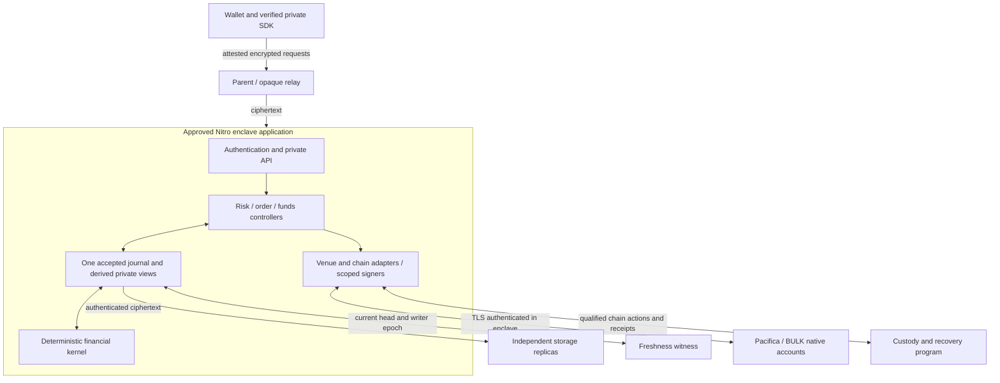

# Cinder architecture

Cinder maintains individual customer entitlements while executing through pooled
perpetual-futures venue accounts. It is a broker, not an internal matching engine,
investment pool or blanket guarantor of venue losses. There is no internal crossing.

This describes the implemented boundaries and approved operating model. Actual
qualification and remaining limitations belong in [status](status.md); exact
financial policy is in the [financial contract](implementation/BASELINE.md).
Detailed rationale is indexed under [architecture decisions](architecture/README.md).

## Runtime and trust boundaries



The parent is not the financial backend: it forwards bounded traffic and stores
ciphertext. Private authentication, policy, accounting and signing remain inside
the enclave. A compromised parent can deny service and observe bounded traffic
metadata; encryption does not guarantee availability.

External venues establish their own executions and balances. Cinder establishes
the attribution of customer claims under its financial contract. Solana establishes
custody modes, escrow consumption and payout counters. Reconciliation joins those
authorities; none can be replaced by an unverified host response or an admin balance.

## Components and ownership

| Component | Responsibility |
| --- | --- |
| `crates/kernel` | Dependency-free `no_std` amounts, positions, ledger, funding, risk, claims, liquidation and ADL allocation |
| `crates/journal` | Atomic accepted history, immutable identities, holds, replay, encrypted records, replicated packs, freshness and unit composition |
| `crates/api` | Owner/agent authorization, durable command semantics and owner-scoped private views |
| `crates/pacifica`, `crates/bulk` | Venue-specific bytes, signatures, bounded transport, observations and qualified normalization |
| `crates/service` | Runnable enclave assembly, attestation/key loading, confidential ingress/egress, controllers and finite workers |
| `crates/web-channel` | Shared Rust/WASM Noise and attestation-context core |
| `crates/ports`, `crates/test-support` | Typed external boundaries and explicitly separate deterministic fixtures |
| `clients/private`, `services/web-relay` | Private browser/Node SDK and opaque HTTP/WebSocket carrier |
| `programs/cinder-vault`, `clients/vault` | Anchor custody/recovery executable, generated ABI and unsigned client builders |

These are nine Rust packages, not nine independently deployed services. The
Anchor workspace is isolated from the off-chain workspace. Node runs client/relay
tooling, not the financial engine. There is no separate signup or balance database.

## Accounts and execution units

A wallet authorizes a Cinder account, which is not a per-user native venue account.
Backend onboarding supports an explicit new-history path for ownership, discovery
and unsigned escrow preparation. Selected measured-unit deployments also support
a private managed-owner inventory; that is not public custody onboarding.

An execution unit binds its native account, markets, quote asset/precision,
custody route, source identities, key policy and financial state. Pacifica and
BULK units share one accepted deployment history, owner inventory and revocation
epoch, but keep financial books, reservations, capital and exposure attribution
unit-local. The registry rejects aliases that would count the same backing twice.
There is no automatic cross-venue margin or interchangeable native collateral.

The explicit unit API/`UnitClient` is version 2. Legacy API/`PrivateClient` remain
version 1; they are not fallback routes or an implicit history migration.
See ADRs [0034](architecture/0034-execution-unit-boundary.md),
[0035](architecture/0035-unit-journal-foundation.md) and
[0036](architecture/0036-unit-api-contract.md).

## Client authentication and private transport

The SDK checks the AWS attestation chain, approved non-debug measurement,
freshness, deployment context and enclave session-key binding before releasing
private requests. Browser/Node clients use the shared Noise core over HTTP or
WebSocket; the legacy Node profile also has enclave-terminated TLS.
Outer HTTPS/WSS is a carrier, not the private trust boundary.

Customer signatures authorize Cinder operations. An owner can grant a Cinder
agent bounded capabilities; this is separate from a native venue agent that
signs pooled-account actions inside the enclave. Native keys are never delegated
to customers. Revocation and current authority are checked before replay/query
or response publication; accepted historical requests do not bypass current scope.

Both transports reach the same handler, permissions and journal. Reads and bounded
subscriptions expose accepted, owner-attributed projections, not a separate
eventually consistent balance service. Disconnects require operation lookup and
resynchronization, not automatic financial retries. Exact request, paging and
delivery semantics are in the [SDK](../clients/private/README.md),
[web contract](architecture/0021-confidential-web-api.md) and
[private read contract](architecture/private-read-contract.md).

## Order lifecycle

1. The owner or permitted agent signs a unit-bound intent with original request
   identity, deadline, market, quantity and execution limits.
2. The handler authenticates it and evaluates the joined customer/native margin,
   pending outcomes, concentration, capital and location-liquidity constraints.
3. One accepted journal decision records the intent, quota and holds. Before a
   signature can escape, a native attempt binds exact bytes, nonce and authority.
4. A bounded worker performs native I/O outside the financial writer, using only
   qualified unit/account routes and permitted signing roles.
5. Original authenticated observations are retained. Actual fills update the
   native and attributed private books once; partial fills and reversals retain
   exact remaining basis and explicit fees.
6. Completion requires the applicable qualified evidence. An ACK is not a fill;
   cancellation is not complete fill history; timeout/not-found is not proof of
   rejection. Unknown effects retain their commitments through replay.

Native netting is not internal customer matching. Private reduce-only semantics
must check the customer's position independently of the pooled account; a label
does not prove lower total pool risk. Known adverse events remain ingestible when
new admission is frozen. See ADRs [0007](architecture/0007-order-lifecycle.md),
[0009](architecture/0009-joined-risk.md) and
[0040](architecture/0040-unit-native-execution.md).

## Financial accounting

The authoritative state separates customer, house and suspense ownership; signed
cash, quantity, remaining basis, unsettled funding, physical assets, transit,
claims, commitments and source evidence have distinct meanings.

For a common qualified mark, ignoring explicit conversion multipliers here:

```text
customer equity = cash + quantity × mark − remaining basis + unsettled funding
native quantity = sum(customer quantities) + house quantity + suspense quantity
reconciled net assets = sum(customer equities) + house equity + suspense equity
```

Opening a perp is not a spot notional debit. Fill value, basis splits, realized
PnL and fees use checked integer units and declared conversion/rounding rules.
Negative customer equity is not automatically a collectible asset backing another
customer's positive claim. Net-flat native exposure does not establish adequate
gross customer backing, margin or liquidity.

Funding recognition and settlement are separate: an accrued amount becomes cash
once, not a second earning. Allocation uses the qualified position/boundary cut,
not whichever positions happen to exist when a delayed response arrives. Native
cumulative funding, equity and display prices are observations—not setters for
cash or basis. Unsupported precision or causality stays retained and contained.

Customer assets are not house insurance capital. Coverage recognition,
reservation, absorption, payout and later recovery are distinct transitions;
the same loss or resource cannot be charged/counted twice. Genuinely free
collateral can be withdrawn with open positions only when outcome-aware risk and
liquidity checks pass. Solvent FIFO is not an insolvency loss-allocation policy.

RF1 preserves original entry economics only for actually restored ADL quantity;
house owns qualified replacement differences/costs. RF2 allocates removed lots
proportionally at a fixed cut with explicit whole-lot bounds and deterministic
restoration quotas. Neither promises uninterrupted healthy-user exposure.
The [financial contract](implementation/BASELINE.md) preserves the full equations,
coverage boundaries, RF1/RF2 rules and G01–G05 gates. The test
[conformance map](implementation/CONFORMANCE.md) links requirements to code.

## Deposits, venue collateral and payouts

```text
owner wallet → customer/venue/asset escrow → allowlisted Cinder funding wallet
             → venue deposit rail → qualified native account credit

venue return → allowlisted funding wallet → venue-specific PDA payout vault
             → registered customer wallet
```

Each deposit is an exact identified batch. Until its full sweep commits, the
owner may refund it; refund and sweep consume the same batch exclusively.
Unsolicited raw balance changes do not create credit or another sweep allowance.
A qualified finalized handoff recognizes the attributable deposit once, while
funding restrictions remain until actual venue credit/readiness qualifies.
Internal movement is not a second customer deposit.

The funding-wallet hop is an explicit native authorization boundary: a Solana
PDA cannot sign a venue's ordinary HTTP requests. Its authority and supported
deposit/return rail must be qualified, not inferred from a token transfer.
Useful credited collateral can remain at the venue between orders; an expected
arrival is not available margin. Unsupported/partial credit remains pending.

Normal and recovery returns use the payout vault, never the auto-swept ingress
escrow. Payment ends at the registered wallet and advances shared paid counters
only on qualified completion. Legacy common-vault instructions remain explicit;
no old-route deployment, counter or journal migration is implied by the escrow
implementation. See [ADR 0030](architecture/0030-venue-directed-escrow.md),
[program setup](../programs/README.md) and
[unit custody/recovery](architecture/0041-unit-custody-recovery.md).

## Persistence, scheduling and fencing

Native requests, accepted operations and economic events have different IDs.
Duplicate same-ID/same-content input is idempotent; conflicting content is not
an overwrite. Postings, consumed IDs, holds and version commit atomically.
An uncertain commit poisons the writer until protected reopen/reconciliation.

Local journal backends and measured external-storage ports share the acceptance
contract. Current measured profiles use bounded encrypted history packs over two
S3 replicas and a separate DynamoDB witness. Authenticated ciphertext alone cannot
detect complete rollback: restore verifies the current accepted head and writer
epoch. Repair must preserve the declared replication/freshness policy.

The writer does not hold its lock across network I/O. Preparation, external work
and completion are bounded stages; private projections are derived from accepted
state and rechecked before publication. Pack layouts, replay versions, quotas,
poll/dispatch allocations and leases are explicit—not production capacity claims.

Nitro has no durable private disk. KMS release policies bind measured roles,
context and PCRs; revoking release does not revoke a key already loaded or an
escaped venue action. Epoch fencing, native capability revocation where supported
and original-action reconciliation address different parts of cutover.
See ADRs [0006](architecture/0006-encrypted-durability.md),
[0025](architecture/0025-concurrent-private-reads.md),
[0026](architecture/0026-retained-history-packs.md) and
[0043](architecture/0043-unit-workers.md).

## Recovery

Recovery is operator-assisted, followed by customer-executable claims:

```text
freeze ordinary authority → fence writers/signers and reconcile escaped effects
→ settle positions/funding/costs → return available assets → finalize entitlements
→ prepare encrypted claim packages and segregated backing → operator activation
→ customers claim once without the ordinary trading API
```

A failed heartbeat or stale checkpoint cannot authorize payment. Unknown venue
outcomes and inaccessible collateral do not disappear or turn into payout cash.
Unswept escrows stay segregated from recovery backing. Normal and recovery paths
share consumption, so activation/root replacement cannot reset prior payments.

The approved recovery path binds the settled journal cut, chain counters,
recipient inventory and funded immutable root. Encrypted per-recipient claim kits
are retrievable outside the trading API; the independent claimant checks live
context and prepares a constrained Solana claim. Owner, domain, epoch, asset,
recipient, proof and remaining capacity are checked by the program.

Merkle inclusion proves membership, not complete liabilities, actual backing or
unconditional exit. Public deposits/payouts reveal their ordinary chain details;
this is private account processing, not private transfers. See ADRs
[0017](architecture/0017-recovery-claims.md) and
[0041](architecture/0041-unit-custody-recovery.md).

## Measured profiles and qualification

| Profile | Implemented boundary |
| --- | --- |
| Legacy explicit profiles | Original v1 service/financial history; no automatic unit migration |
| Manifest 7 | Two-unit confidential assembly and managed empty-owner inventory; no native financial activation |
| Manifest 8 | Bounded unit workers and private SDK; fresh books still lack qualified capital/readiness |
| Manifest 9 | Separate short-lived fresh-account BULK paper experiment, one-time split of actual faucet backing, quarantined history and fixed cleanup/dispatch budgets |

The paper profile is not a funding rail, production readiness setter or customer
deposit. It cannot reopen in ordinary releases or renew its expired authority.
Pacifica and BULK native guarantees must be qualified separately; a common SDK
does not establish identical margin, fee, funding or withdrawal semantics.

The current evidence boundary and next local precision/funding work are in
[status](status.md). Offline suites use explicit fake venue/chain/time ports;
compiled SBF, actual Nitro and bounded native observations qualify their own
boundaries only. No production/key/customer-funds permission follows from CI,
attestation, a paper run or a stack merge.
